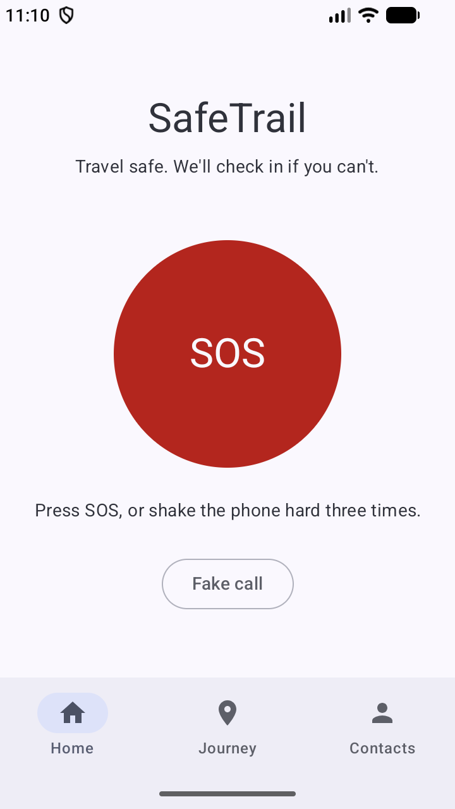
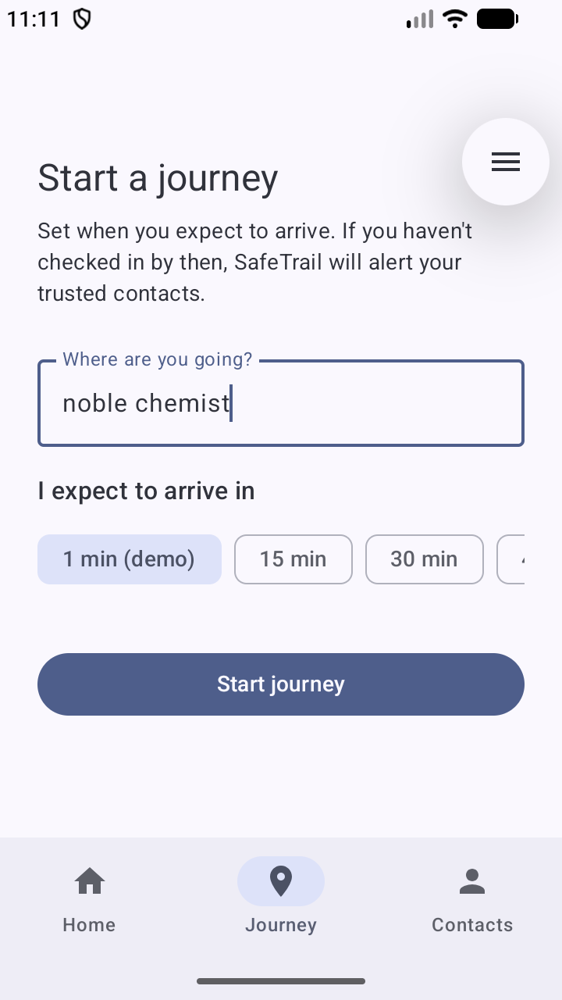
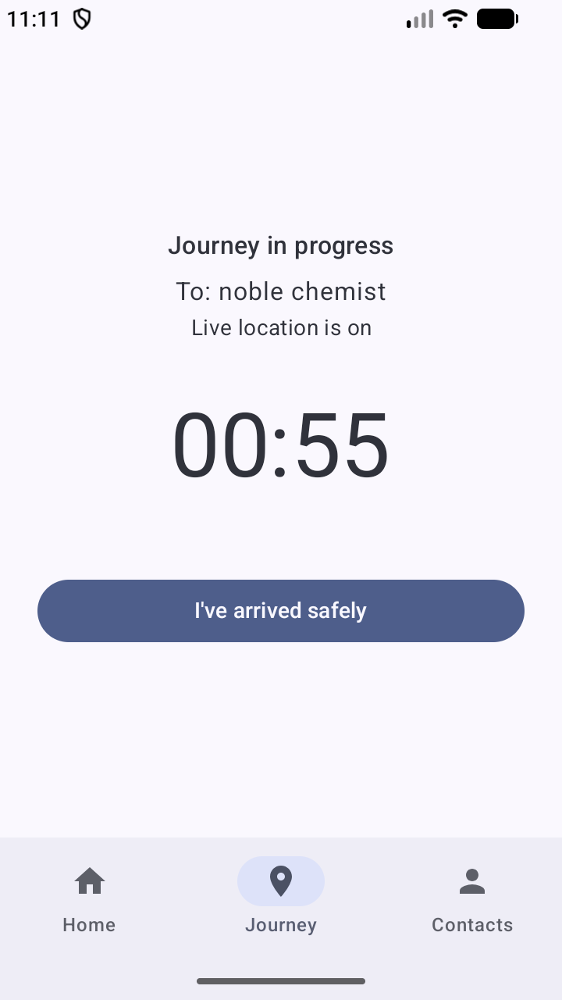
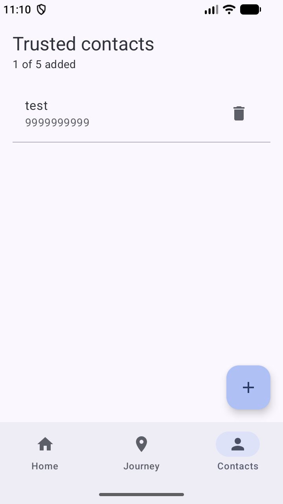
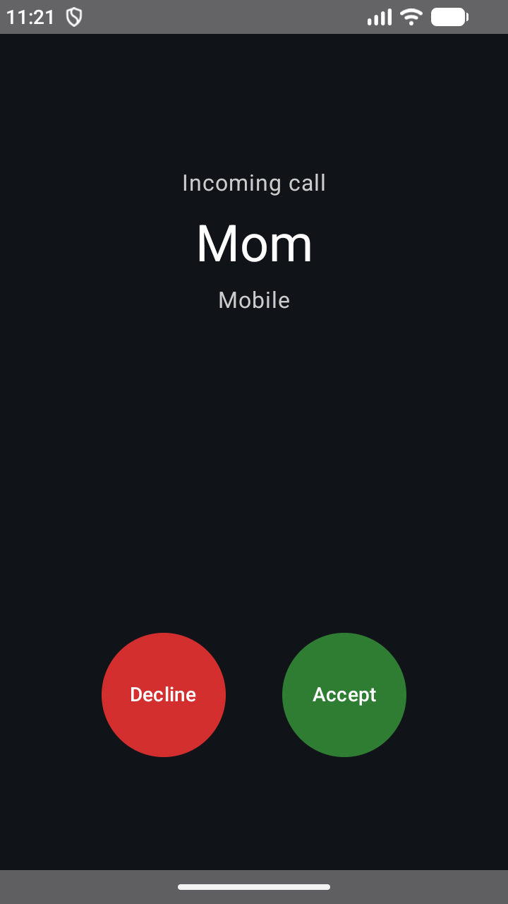

# SafeTrail

Proactive journey check-in and personal safety app for students, built as the project for the Mobile and Application Development course.

Most safety apps only help if you can press a button while in danger. SafeTrail works when you cannot: you start a journey with an expected arrival time, and if you do not check in, the app alerts your trusted contacts by itself, with a map link to your last location.

## Features

- **Trusted circle**: save two to five emergency contacts, stored on the phone.
- **Journey check-in**: set a destination and an ETA, then tap "I've arrived safely" when you get there.
- **Automatic escalation**: if the countdown ends, SafeTrail asks "Are you safe?" and gives 30 seconds to answer. If there is no reply, it sends an SMS to every trusted contact.
- **Live location**: a foreground service keeps your position updated during the journey, and the alert carries a Google Maps link.
- **SOS and shake-to-SOS**: press SOS or shake the phone hard three times. A 5 second countdown lets you cancel a false alarm.
- **Fake incoming call**: a realistic call screen with a caller name, ringtone and ring delay, to help you leave an uncomfortable situation.

## Screenshots

| Home | Journey | Journey in progress | Contacts | Fake call |
|------|---------|---------------------|----------|-----------|
|  |  |  |  |  |

## Built with

- Kotlin, Jetpack Compose and Material Design 3
- Room (with KSP) for the local database, Kotlin Flow for live updates
- Fused Location Provider (Google Play services) and a foreground service for location
- AlarmManager exact alarms, BroadcastReceiver and notifications for the check-in
- SensorManager (accelerometer) for shake detection
- SmsManager for the alert messages

## Run it

1. Open the project in Android Studio and let Gradle sync.
2. Run the app on an emulator (Google Play image) or a real Android phone, Android 8.0 or newer.
3. Add a trusted contact, then start a journey. The "1 min (demo)" option is there to try the full alert flow quickly.

On an emulator, set a fake location with `adb emu geo fix <longitude> <latitude>`.

## Permissions

| Permission | Why it is needed |
|------------|------------------|
| SEND_SMS | send alerts to trusted contacts |
| ACCESS_FINE_LOCATION, ACCESS_COARSE_LOCATION | add your location to alerts |
| POST_NOTIFICATIONS | show the "Are you safe?" prompt |
| USE_EXACT_ALARM | fire the check-in at the exact ETA |
| FOREGROUND_SERVICE, FOREGROUND_SERVICE_LOCATION | keep location fresh during a journey |
| VIBRATE | vibrate during the fake call |

## Known limitations

- Shake-to-SOS works while the app is open. Shake detection in the background is planned.
- Google Play restricts the SMS and exact alarm permissions, so a public release would need a different delivery method for alerts.
- Alerts depend on mobile signal and the phone being switched on.

## Project docs

- [Work log](docs/worklog.md)
- [Privacy policy](docs/PRIVACY.md)

## Author

Kunal Chauhan, roll number N018. Mentor: Prof. Fahim Khan.
